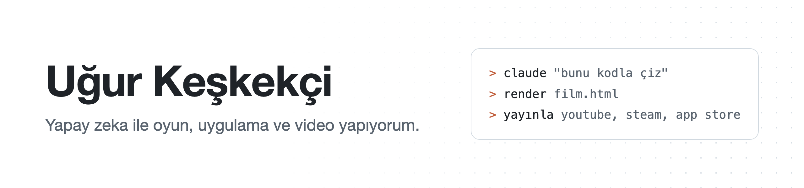

<picture>
  <source media="(prefers-color-scheme: dark)" srcset="assets/banner-dark.png">
  
</picture>

Ankara'dan yazılım geliştirici ve içerik üreticisiyim. YouTube'da Claude Code, Codex ve Cursor gibi yapay zeka
araçlarıyla gerçek projeler yapıyorum. Videolarda kullandığım kitleri burada açık kaynak olarak paylaşıyorum:
repoyu Claude Code'a verin, "bu sistemi kur" deyin, gerisini o halletsin.

## Açık kitler

- **[kodla-animasyon-kit](https://github.com/UgurKeskekci/kodla-animasyon-kit)**: görsel model olmadan, her karesi kodla çizilen kısa animasyonlar. Sahneyi anlatırsınız, Claude çizer ve MP4'e çevirir.
- **[kodla-tiktok-yayinci](https://github.com/UgurKeskekci/kodla-tiktok-yayinci)**: slime yoğuran, yorumlara sesli cevap veren, kodla çizilmiş yayın karakteri. Menüden kendinizinkini yapın, TikTok canlı yayınına bağlayın.
- **[claude-video-kit](https://github.com/UgurKeskekci/claude-video-kit)**: konuşma videolarını Claude Code ile kurgulamak için skill'ler. Yatay kaba kurgu, dikey Reels, hareketli grafik.
- **[creator-hub-marketing](https://github.com/UgurKeskekci/creator-hub-marketing)**: oyununuzu tanıtacak küçük YouTube kanallarını bulur, puanlar ve onlara mail atmanızı sağlar.
- **[image-generation-saas](https://github.com/UgurKeskekci/image-generation-saas)**: görsel ve video üreten, kredili ve abonelikli tam bir SaaS örneği (React, Node.js, Supabase).

## Şu an üzerinde çalıştıklarım

- **[Chest & Blade](https://store.steampowered.com/app/3833200/Chest__Blade/)**: Misto Games ekibiyle yaptığımız idle RPG. Demo Steam'de, tam sürüm 10 Aralık 2026.
- **[Kimin Parası?](https://apps.apple.com/app/id6826825422)**: ipuçlarından suçluyu bulduğunuz gizem oyunu, App Store'da.
- **Kodla video**: görsel üretim modeli kullanmadan, kodla çizilen animasyon ve hikaye serileri.

## Kullandığım araçlar

## Kurslar

- [Cursor AI ile mobil uygulama geliştir ve markette yayınla](https://www.udemy.com/course/cursor-ai-ile-mobil-uygulama-gelistir-ve-markette-yaynla/?referralCode=132BB37C132C972A020C) (Udemy)
- [Sıfırdan yapay zeka ile kod yazmadan web uygulaması geliştir](https://www.udemy.com/course/sifirdan-yapay-zeka-ile-kod-yazmadan-web-uygulamas-gelistir/?referralCode=29A4F57208634CFCB93B) (Udemy)

---

Software developer and YouTuber from Ankara, Türkiye. I build games, apps and videos with AI coding agents and share the kits here. Videos are in Turkish.
